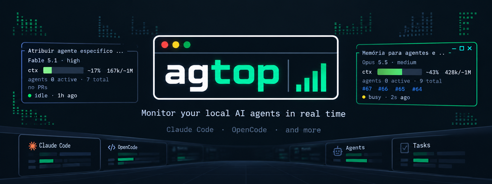
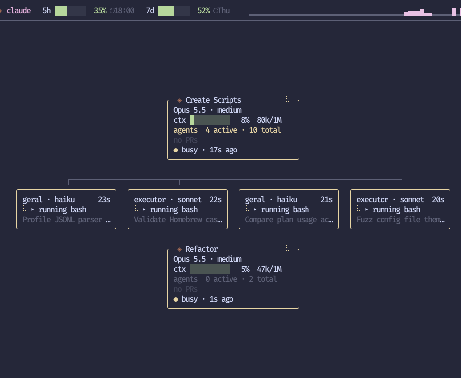
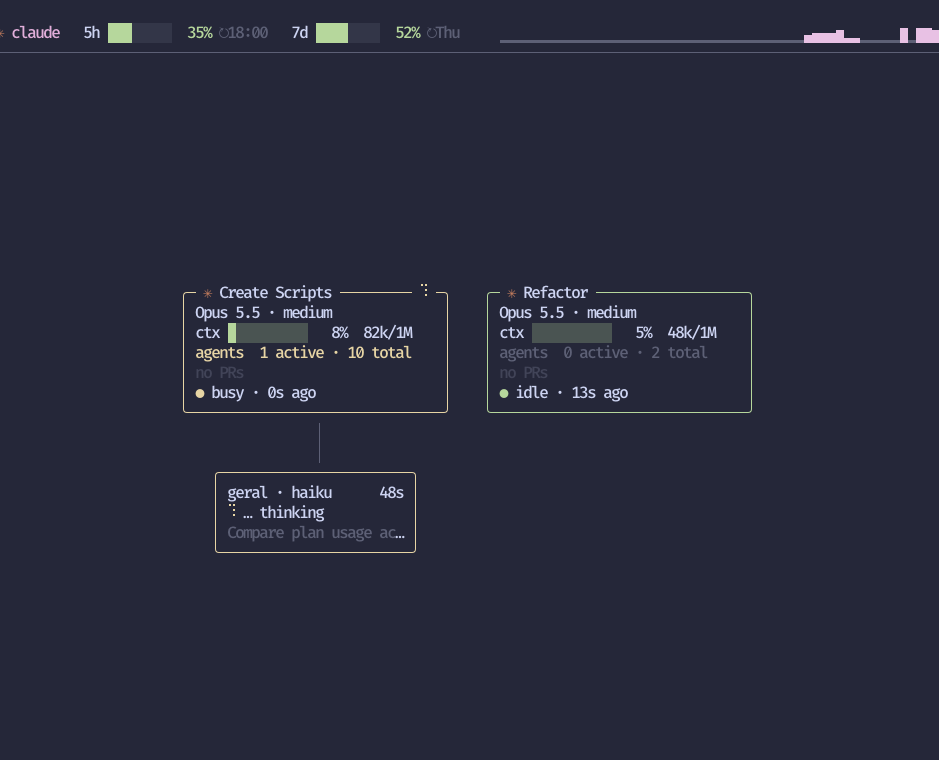

<p align="center">
  
</p>

# agtop

A live terminal UI for the Claude Code sessions running on your machine and the
sub-agents each one launched. Think `htop`, but for your agents.

Each session is a box with its active agents hanging below it:

<p align="center">
  
  
</p>

What you see:

- **Top bar**: one line per profile with the 5-hour and 7-day plan usage, their reset
  times, and the profile's recent activity.
- **Session boxes**: title, model and effort, context usage, active and total agents,
  pull request links (`#201`, clickable in the terminal) and the session state, colored
  by state: busy (yellow), shell (cyan, a background command is running), waiting (red,
  it needs you), idle (green) and pending (gray, a background session that has not
  started yet).
- **Agent boxes**: agent name, model, duration and what it is doing right now (writing
  code, reading, searching, running tests, building, git...).
- **Detail view** (Enter): every agent of the session, including finished ones, with
  status, tokens and pending tools.

agtop only shows metadata. Prompts, commands and tool outputs are never displayed or
stored: from a Bash command it keeps only a category (tests, build, git...), and from
an output only a pull request number. Pull requests come from Claude's own text, `gh`
commands and sub-agent results.

## Requirements

- macOS or Linux
- A recent Claude Code (one that writes `sessions/<pid>.json` in its config directory)
- Go 1.26 or later, only to build from source

## Install

Homebrew (macOS):

```bash
brew install danielfnfaria/tap/agtop
```

Script (macOS and Linux, amd64/arm64; installs to `~/.local/bin`):

```bash
curl -fsSL https://raw.githubusercontent.com/danielfnfaria/agtop/main/install.sh | sh
```

Set `AGTOP_VERSION=0.1.0` to pin a version or `AGTOP_INSTALL_DIR=/usr/local/bin` to pick the
directory.

With Go:

```bash
go install github.com/danielfnfaria/agtop@latest
```

From source:

```bash
git clone https://github.com/danielfnfaria/agtop.git
cd agtop
go build -o agtop .
./agtop
```

## Plan usage (5h / 7d)

Claude Code hands the plan usage limits only to the status line command, so agtop
records them with a small hook placed in front of your status line. Set it up once per
profile:

```bash
agtop setup            # shows the change to settings.json and asks before writing
agtop setup --dry-run  # only show what would change
agtop setup --yes      # apply without asking (needed without a terminal)
agtop setup --remove   # put the original status line back
```

Your status line keeps working exactly as before: the hook stores the usage numbers in
`<config dir>/agtop/usage.json` and, next to it, the context window size of each session
(session id, model id and size, nothing else) in `<config dir>/agtop/context.json`, and
passes everything else through. Without a status line, the hook prints a short one
(`agtop · 5h 6% · 7d 30%`). Before writing, `setup` backs `settings.json` up as
`settings.json.bak-agtop-<time>`.

The numbers update while at least one session of that profile is open; data older than
10 minutes, or whose window has already reset, shows as stale. Without the setup, agtop
works normally and shows `—` for 5h and 7d.

## Configuration

agtop reads a TOML file, `$XDG_CONFIG_HOME/agtop/config.toml` or, when that variable is
unset, `~/.config/agtop/config.toml` (also on macOS). On the first run without it, agtop
creates the file with the directory it would watch and commented hints. Use
`--config <path>` to read another file; it must exist. Only the tables below are
accepted; any other key is an error.

```toml
[profiles]
personal = "~/.claude"
work = "~/.claude-work"
```

`[profiles]` maps a label (shown in the viewer) to a Claude Code config directory, in
the order of the file. Paths are absolute or start with `~`; two labels for the same
directory and provider are an error. `agtop setup` reads the same file (and `--config`), so it wires
the same profiles.

An opencode profile is a table instead of a path. `dir` is optional (default
`$XDG_DATA_HOME/opencode`, else `~/.local/share/opencode`) and must contain `opencode.db`:

```toml
oc = { provider = "opencode" }
```

agtop reads the opencode sessions straight from that database, read-only (a single
connection in `mode=ro`: it never writes the database or its WAL and never checkpoints;
SQLite may create the shared-memory `opencode.db-shm` file, as any reader does), selecting
only metadata: titles,
models, tokens, tool names and the file or command category they act on. Sub-agents are the
child sessions of the `task` tool. The context window comes from opencode's own model catalog
(`~/.cache/opencode/models.json`) when it has the model. `agtop setup` skips these profiles.

Without `[profiles]`, agtop watches `CLAUDE_CONFIG_DIR` (the same variable Claude Code
uses) if it is set, otherwise `~/.claude`, labelled by the directory name. It does not
look for other profiles on its own.

With a single profile the screen shows no profile names. With two or more, each session
shows its profile and `p` filters by profile.

### Appearance

All optional and independent of `[profiles]`; the defaults are the standard look.

```toml
[theme]
preset = "dark"                  # dark | light
busy = "yellow"                  # per role: muted accent busy shell waiting idle
waiting = "#ff5f5f"              #   pending done failed ok warn critical link
profiles = ["magenta", "blue"]   # palette of the profiles (cycles)

[glyphs]
preset = "ascii"                 # unicode | ascii (+-| borders, # . bars)
dot = "*"                        # per slot, see `agtop --help`
spinner = ["-", "\\", "|", "/"]

[layout]
top_bar = true                   # false: never show the usage/activity bar
time = "relative"                # relative ("5m ago") | absolute ("14:03:21")
sparkline = true                 # false: profile lines with the usage only
```

Colors are names (`black`, `red`, `green`, `yellow`, `blue`, `magenta`, `cyan`, `white`,
`gray` and the bright forms, e.g. `cyanBright`) or `#rgb` / `#rrggbb`. A glyph must take
exactly one terminal column. `NO_COLOR` turns every color off, whatever the theme.

### Context window

The context bar takes the window size from, in this order:

1. the size Claude Code reported for that session (needs `agtop setup`, see above);
2. the size reported by another session of the same profile and model;
3. the `[1m]` suffix of the model id (1M);
4. a table by model generation: Opus and Sonnet from 4.6, Fable and Haiku from 5 have 1M,
   earlier generations 200k.

Unknown models use 200k, and if usage goes past the table window agtop assumes 1M; both
are marked with `~` (estimated). Without `agtop setup`, only 3, 4 and this estimate apply.

## Keys

| Key | Action |
| --- | --- |
| ←↑→↓ / hjkl | select a session (in the detail view, an agent); nothing is selected at start |
| Enter | open the selected session; in the detail view, expand the agent |
| x | close the selected session in the tree (SIGTERM, after a confirmation) |
| Tab | switch the detail panel (agents / pending tools) |
| Esc / Backspace | back to the tree; in the tree, clear the selection |
| p | filter by profile (only with two or more profiles) |
| ? | help, watched directories and recent errors |
| Ctrl-L | redraw the whole screen |
| q / Ctrl-C | quit |

## How it works

agtop only reads files Claude Code already writes. Apart from the optional
`agtop setup`, it changes no configuration.

- `sessions/<pid>.json` tells which sessions are open and their state. agtop checks
  that the process is still alive and ignores records from before the last boot.
- `projects/<project>/<sessionId>.jsonl` is the session transcript, read incrementally.
- `projects/<project>/<sessionId>/subagents/agent-<id>.jsonl` and `.meta.json` hold
  each sub-agent's transcript and metadata.

Without a terminal on stdin or stdout (a pipe or a redirection), agtop renders once and
exits.

## Limitations

- These files are internal to Claude Code and can change between versions. Unknown
  lines are ignored, but a new version may need adjustments.
- Updates arrive through file events, with a scan every 2 s as a safety net, so the
  first agent of a session can take up to 2 s to show up.
- Errors and warnings raised while the screen is taken over are held and printed when
  you quit.
- The tree shows open sessions (a session that closes stays 30 s marked as ended) and
  only their active agents. The full agent history is in the detail view.
- opencode keeps no session registry: each running `opencode` process is shown as the most
  recently touched session of its working directory that was touched since the process started.
  So a session resumed from `/sessions` appears at its first new message, two opencode processes
  in the same directory show the two most recent sessions (the newest process takes the newest
  session), and `x` closes the process shown. Permission requests are not persisted, so an
  opencode session is never shown as waiting.

## Development

```bash
go run .            # run from source
go test ./...
golangci-lint run
go build -o agtop .
```

Commits follow [Conventional Commits](https://www.conventionalcommits.org/)
(`feat:`, `fix:`...), which release-please reads to cut releases.

## License

[MIT](LICENSE)
